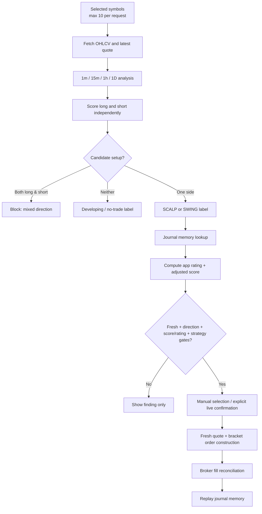

# Fin Killer Pro — Setup Detection, Rating, and Execution Audit

**Audit type:** source-code review of the supplied Android project  
**Review date:** 13 October 2026  
**Scope:** the active `DirectTradingViewModel` / `DirectTradingApp` path, Alpaca market scanner, eligibility rules, journal-memory rating, bracket construction, risk observer, and their JVM tests.  
**Not performed:** no broker connection, order, real-time scan, historical backtest, or profitability claim.

> **Bottom line:** the app has a clear and mostly auditable *rule-qualified setup* framework. A high score means several binary technical conditions were true in the fetched bars; it does **not** mean the setup has a demonstrated probability of profit, a calibrated confidence level, or a validated expected return. The source contains no historical backtest, out-of-sample validation, cost/slippage model, or calibration analysis. Before live use, the score/risk-to-reward disconnect and the execution-risk gaps should be addressed.

> **Implementation status (13 October 2026):** the analysis below first describes the supplied pre-change source. A follow-up implementation pass then changed setup scoring, data gates, risk sizing, journal isolation, authentication, and paper-only execution. Read **“Implementation addendum and verification status”** at the end for current behavior; it supersedes pre-change execution and risk findings. Tasks 1–5E were implemented to the extent itemized there; mobile UI/manual verification and several specifically requested tests remain outstanding. Tasks 6–8 are not complete, except the Task 7 credential/documentation improvements.

---

## 1. Executive answer: what makes a setup “good” here?

In this codebase, a setup is called **good** only in the operational sense that it passes a sequence of hard-coded technical checks and, later, app-specific memory gates. It is **not** proven good by empirical performance.

A candidate must normally have:

1. A directional technical signal (**LONG** or **SHORT**) from OHLCV bars;
2. Sufficient trend / location / event / volume / modeled reward-to-risk confluence to form a `SCALP` or `SWING` candidate;
3. No simultaneous valid long and short candidate;
4. A current scan that is no more than three minutes old;
5. An **adjusted scanner score** of at least 72/100;
6. An **app rating** of at least 72/100, where the app rating blends the current scan and prior journal outcomes;
7. For live equity orders, an `isExecutableSetup` confirmation; and
8. At submission, extra broker-specific checks for a short sale.

Any colloquial praise for a candidate should therefore be read only as “passes the current rules and gates,” not “has a verified edge.”

### The three values that must not be conflated

| Value | Formula / source | What it actually represents | Is it a probability of success? |
|---|---|---|---|
| **Scanner score** `S` | 0–100 sum of binary technical checks | Current-bar technical confluence | No |
| **Memory rating** `M` | Journal replay of weighted past wins/losses for the setup family | Internal historical heuristic | No |
| **App rating** `A` | `round(0.70 × S + 0.30 × M)` | Blend of current confluence and remembered outcome record | No |
| **Adjusted score** `E` | `clamp(S + memory adjustment, 0, 100)` | Scanner score with a directive penalty/bonus | No |

The code requires **both** `A >= 72` and `E >= 72`; a raw score above 72 by itself is not enough.

---

## 2. Architecture and data flow



### Data collection

For equities, `DirectEnvironment.scanMarkets()` sends one batch request per timeframe, using the Alpaca IEX feed, then analyzes every requested symbol independently:

| Timeframe | Lookback configured in code | Purpose in the model |
|---|---:|---|
| `1Min` | 3 days | Scalp component |
| `15Min` | 14 days | Scalp component |
| `1Hour` | 30 days | Swing component |
| `1Day` | 45 days | Swing component |

The implementation uses a **timeframe-first batch strategy**: four market-data requests for up to ten symbols, plus a latest-quote request. This is efficient relative to four requests per symbol.

For forex, it fetches midpoint-rate samples, derives 15-minute and hourly bars locally, and labels the result data-only for the Alpaca stock-order route. Forex is not submitted through the equity order endpoint because slash symbols are explicitly blocked by eligibility.

### Inputs and outputs retained for review

`MarketSnapshot` retains more than a single score: symbol, last price, score, scalp/swing sub-scores, setup label, direction, execution-gate text, per-timeframe diagnostics, and a short rationale. The UI exposes those three numerical views — scan score, app rating, and adjusted score — rather than hiding the blend.

That transparency is a real design strength. It makes it possible to explain *why the app considered something*, even though it does not yet prove that the conclusion has statistical value.

---

## 3. The technical setup model, exactly

The core analysis is `DirectAlpacaClient.analyzeBars(...)`. It is deterministic and evaluates each timeframe **twice**: once as long and once as short.

### 3.1 Indicators and microstructure rules

For a bar series with at least two observations, the code derives:

| Component | Long rule | Short rule | Notes |
|---|---|---|---|
| **EMA alignment** | `close > EMA(9)` and `EMA(9) >= EMA(21)` | `close < EMA(9)` and `EMA(9) <= EMA(21)` | `EMA` begins from the first available close, rather than a fully warmed-up historical seed. |
| **VWAP confirmation** | `close > VWAP` | `close < VWAP` | VWAP is calculated across the entire fetched bar window, not reset at the cash-session open. |
| **Breakout / breakdown** | last close above the prior 20-bar high | last close below the prior 20-bar low | The current candle must close through the range. |
| **Liquidity sweep** | last low below prior 20-bar low and last close back above that low | last high above prior 20-bar high and last close back below that high | This is a sweep-and-reclaim/rejection pattern. |
| **Volume expansion** | latest volume >= 1.5× mean of prior bars | same | No relative-volume-by-time-of-day adjustment. |
| **ATR stop** | `close - ATR` if no sweep; sweep low otherwise | `close + ATR` if no sweep; sweep high otherwise | ATR uses a 14-bar true-range average. |
| **Modeled target** | greater of prior high and `close + 1.5/2.0 × ATR` | lesser of prior low and `close - 1.5/2.0 × ATR` | 1.5 ATR for scalp; 2.0 ATR for swing. |
| **Modeled R:R** | `(target - close) / (close - stop)` | `(close - target) / (stop - close)` | Used for the scanner only; see the important execution mismatch in Section 7. |

The EMA multiplier is standard: `α = 2 / (period + 1)`. The scanner’s “trend percent” and “volatility percent” are produced for explanation, but they do **not** determine candidate eligibility beyond the binary score elements.

### 3.2 Scanner score composition

Each timeframe / direction receives this exact score:

| Test | Points | Interpretation |
|---|---:|---|
| EMA alignment | 25 | Trend and price position agree |
| VWAP confirmation | 15 | Price is on the intended side of the computed VWAP |
| Breakout **or** liquidity sweep | 20 | There is an explicit range event |
| Volume expansion | 15 | Latest bar volume is at least 1.5× prior average |
| Modeled R:R meets mode threshold | 15 | `>=1.5` scalp or `>=2.0` swing |
| At least 20 bars in this series | 10 | Minimal history bonus |
| **Maximum** | **100** | Binary confluence score |

So the score is a **weighted checklist**. It is not an estimated win rate. A score of 85 means that the rules adding to 85 were true; it does not establish that 85% of trades win, or that the expected return is better than a score of 75.

### 3.3 Scalp and swing candidate definitions

The scoring and the candidate checks are deliberately separate.

| Setup type | Timeframes | Candidate requirements |
|---|---|---|
| **Scalp** | 1-minute and 15-minute | Both timeframes must show EMA alignment; at least one must show a breakout or sweep; at least one must show volume expansion; at least one must have modeled R:R `>=1.5`. |
| **Swing** | 1-hour and daily | At least one timeframe must have EMA alignment, a breakout or sweep, and modeled R:R `>=2.0`. VWAP and volume are scored but are **not** mandatory for this candidate definition. |

Within a direction, the scalp score is the truncated average of the 1-minute and 15-minute scores; the swing score is the truncated average of the 1-hour and daily scores. The snapshot’s scanner score is the **maximum** of the chosen direction’s scalp and swing scores — not an average across all four timeframes.

This matters: a displayed 85 does not necessarily mean every timeframe is 85-ish. It may mean the best of the scalp and swing aggregates is 85, while the other horizon is weaker.

### 3.4 Direction handling

The scanner independently computes long and short candidate status:

- **Long only:** direction is LONG and the long score is used.
- **Short only:** direction is SHORT and the short score is used.
- **Both valid:** `direction = null`, label becomes `MIXED LONG/SHORT SIGNALS / NO TRADE`, and execution is blocked.
- **Neither valid:** the stronger raw directional score may be displayed as a developing indication, but `isExecutableSetup = false`.

This is a good fail-closed design: the code does not guess a side where multi-timeframe evidence conflicts.

---

## 4. Why a setup gets the label it does

### Label hierarchy

| Label | Meaning in the code | Live execution status |
|---|---|---|
| `SCALP + SWING / ALIGNED LONG/SHORT SETUP` | Both candidate families pass for one direction | Potentially eligible |
| `SCALP / ... MOMENTUM BREAKOUT OR ... SWEEP` | Scalp candidate passes | Potentially eligible |
| `SWING / ... SETUP` | Swing candidate passes | Potentially eligible |
| `DEVELOPING / HIGH SCORE — EXECUTION GATE NOT CONFIRMED` | High checklist score, but candidate requirements fail | Blocked live |
| `DEVELOPING / MIXED DIRECTION` | Direction unclear or conflicting | Blocked |
| `MIXED LONG/SHORT SIGNALS / NO TRADE` | Both sides are candidates | Blocked |
| `DATA INCOMPLETE / NO OHLCV PARSED` | No usable bar data | Blocked |
| `NO TRADE` | Low/no evidence | Blocked |

### A concrete interpretation example

A **valid long scalp** is saying something specific and limited:

> “On both 1-minute and 15-minute bars, price is above the fast EMA and the fast EMA is at or above the slow EMA. On at least one of those horizons there is either a close above the prior 20-bar high or a downside liquidity sweep reclaimed by the close. At least one has volume expansion and a modeled R:R of at least 1.5.”

That is a coherent **momentum/reversal-confluence hypothesis**. It is not yet a claim about odds, because it has not been validated across symbols, time periods, market regimes, fills, and costs.

---

## 5. How the app rates a setup after scanning

### 5.1 Memory keys

The journal collapses verbose labels into stable families:

- `SCALP`
- `SWING`
- `SCALP+SWING`
- a separate `... SHORT` family for bearish/short patterns

It maintains both:

1. **Symbol-specific memory**, for example `AAPL|SCALP`; and
2. **Cross-market family memory**, for example `*|SCALP`.

This is intended to let an AAPL scalp record and the global scalp family influence a new decision. When both exist, the code uses the **stricter directive** and the worse score adjustment, but uses the symbol record’s rating for the app-rating blend when it exists.

### 5.2 Memory-rating formula

A new setup starts at neutral **50/100**. The journal replays all closed trades chronologically and uses a smoothed, self-weighted win/loss calculation.

For a trade entered with app rating `r` (0–100):

- win weight: `w_win = 0.5 + 0.5 × r/100`  → 0.5 to 1.0
- loss weight: `w_loss = 0.5 + 1.0 × r/100` → 0.5 to 1.5

Then:

```text
Memory rating = floor(100 × (weightedWins + 1)
                         / (weightedWins + weightedLosses + 2))
```

The `+1` / `+2` terms are Laplace smoothing, which prevents an immediate 0 or 100 rating.

### What the weighting does

- A win on a high-conviction trade increases memory more than a win on a low-conviction trade.
- A loss on a high-conviction trade hurts **more** than a loss on a low-conviction trade.
- A one-loss neutral record becomes 33/100; a one-loss record that was rated 90 becomes 29/100.
- Four 90-rated wins produce an 82/100 remembered rating in the included tests.

This is a purposeful **“punish confident mistakes”** heuristic. It is not a conventional calibrated Bayesian posterior, because the weights depend on the app’s own prior score rather than an externally verified probability model.

### 5.3 Directives and score adjustments

| Directive | Typical trigger | Scanner-score adjustment | Practical effect |
|---|---|---:|---|
| `PREFER` | At least two decided trades and rating >=65 | +6 | Makes a qualifying setup easier to pass |
| `ALLOW` | No negative condition | 0 | Neutral |
| `CAUTION` | e.g., rating <45, two consecutive losses, or non-positive 3+ trade expectancy | -12 | Raises the effective raw-score hurdle |
| `PROBATION` | e.g., two high-rated losses with rating <55 | -25 | Very difficult to pass |
| `BLOCK` | e.g., three consecutive losses or sufficiently poor/high-rated loss pattern | -100 | Cannot pass adjusted-score gate |

### 5.4 The actual execution equations

Let:

- `S` = scanner score;
- `M` = selected memory rating;
- `Δ` = directive adjustment.

The app computes:

```text
A = round(0.70 × S + 0.30 × M)          // app rating
E = clamp(S + Δ, 0, 100)                 // adjusted score
```

For an equity candidate to be eligible, it must satisfy **both** `A >= 72` and `E >= 72`, in addition to direction/freshness/setup conditions.

### Effective raw-score thresholds

The advertised minimum is 72, but the effective raw scanner threshold depends on memory.

| Memory situation | Memory `M` | Adjustment `Δ` | Minimum raw `S` that passes both gates |
|---|---:|---:|---:|
| Neutral / no history | 50 | 0 | **81** |
| Caution after a high-rated loss | 29 | -12 | **90** |
| Caution after neutral loss | 33 | -12 | **88** |
| Prefer at 65 memory | 65 | +6 | **75** |
| Prefer at 74 memory | 74 | +6 | **71** |
| Prefer at 82 memory | 82 | +6 | **67** |
| Block | any | -100 | Impossible |

Therefore, **a raw 72 score does not qualify at neutral memory**. The test suite explicitly confirms that scanner 80 with neutral memory yields app rating 71, whereas 81 yields 72.

This is a useful control against treating a freshly discovered, merely okay signal as trade-ready. It also means the label “72-point scanner threshold” is incomplete unless the UI states the memory context — which this UI fortunately does.

---

## 6. The execution gates, in order

A candidate may look strong but still be blocked. The main order path applies the following gates:

1. **Connected environment and in-memory API credentials exist.**
2. **Selected or confirmed candidate exists.**
3. **Freshness:** manual and monitored results expire after 180 seconds.
4. **Direction:** ambiguous / mixed LONG–SHORT is blocked.
5. **Asset route:** slash symbols are analysis-only for the Alpaca equity-order route.
6. **Eligibility:** check scanner/app thresholds, memory adjustment, and strategy confirmation.
7. **Duplicate cooldown:** same symbol cannot be ordered again for 15 minutes in the current ViewModel lifetime.
8. **Short-specific checks:** no current same-symbol position or working order; Alpaca asset must be active, tradable, shortable, and easy to borrow.
9. **Order construction:** obtain a fresh IEX quote if available, then construct a broker bracket.
10. **Live UI confirmation:** live bulk / auto-confirm paths expose a confirmation dialog before sequential submission.

### Paper-mode exception

Paper mode intentionally has a looser route called `paperTestEligible`. It may send a paper order for a directional result with at least two bars and adequate score/rating even if `isExecutableSetup` is false. This is useful for experimentation, but it has an important consequence:

> **Paper outcomes can influence the same journal memory later used by live eligibility.** The journal replay groups all stored trades without filtering on `accountMode`, and paper test entries are recorded through the same ticket/journal mechanism.

That mixes paper fills and potentially unconfirmed/developing setups into the live-rating input. It is a material model-governance flaw if live memory is meant to be live-evidence only.

---

## 7. Critical technical finding: scanner R:R is not the order R:R

This is the most important strategy/execution mismatch in the source.

### Scanner model

The technical score awards 15 points for the scanner’s modeled R:R, which uses:

- an ATR or liquidity-sweep stop; and
- a range/ATR target.

### Submitted bracket

The order path does **not** pass that scanner stop or target into the broker order. Instead it submits a one-share bracket built from a fresh reference quote with fixed percentage geometry:

| Usual case | Stop | Take profit | Nominal R:R |
|---|---:|---:|---:|
| Standard market bracket | 2% | 4% | 2.0 |
| Designated second-basket / retry bracket | 8% | 16% | 2.0 |

If the broker rejects the original stop because the market moved, the code retries at the **wider 8% / 16% geometry**. The code correctly preserves a nominal 2:1 ratio in both cases, but that does not make it the same trade the scanner evaluated.

### Why this matters

A signal may receive its R:R points because a nearby technical invalidation produces, for example, a 1.8R or 2.2R range target. The actual order can instead use a 2% stop and 4% target, or potentially 8% / 16% after retry. That changes:

- distance to invalidation;
- probability of a stop-out;
- holding time;
- expected value;
- position risk in dollars; and
- whether the journal is learning from the intended strategy or a different fixed-bracket strategy.

**Recommendation:** calculate candidate-specific entry, stop, target, and quantity from one frozen quote snapshot; show those exact levels in the setup card; submit those exact levels after final validation or explicitly label the scanner R:R as “display-only and unrelated to the order.”

---

## 8. What is strong about the design

| Area | Strength |
|---|---|
| Directional ambiguity | Both valid directions block the order rather than letting the stronger score guess a side. |
| Explanation | UI exposes direction, scanner/app/adjusted ratings, setup labels, rationale, and scalp/swing details. |
| Freshness | Candidates expire after three minutes and are rechecked before submission. |
| Short controls | Short orders fail closed without active/tradable/shortable/easy-to-borrow confirmation and are blocked if the same symbol already has a position or working order. |
| Order geometry | Long and short fixed brackets keep their target distance at twice stop distance, including the retry path. |
| Broker reconciliation | The journal waits for verified fills and full exit quantity; it retains actual quantity-weighted exit prices rather than inventing a close. |
| Scan monitor boundary | The all-basket monitor is read-only; it scans and notifies but does not itself submit or alter orders. |
| Stop-risk observer | For its supported scope, the observer fails closed if a complete, quantity-covering market stop cannot be verified. |
| Testable pure logic | The scoring, journal, bracket, and risk functions are largely deterministic and unit-testable. |

---

## 9. Gaps that make a high rating less trustworthy

### 9.1 No evidence that the rules have positive expectancy — **critical**

There is no backtest, walk-forward test, out-of-sample report, performance-by-score decile, market-regime analysis, slippage model, fee model, or calibration measurement in the supplied source. The included tests use deterministic synthetic bars and data fixtures; they validate behavior, not edge.

A score of 85 is therefore a code-defined checklist outcome, not an evidence-backed “A-grade trade.”

### 9.2 The 10% stop-risk cap does not block manual or bulk orders — **high**

`OpenStopRiskCalculator` conservatively computes current downside to verified stops and pauses the **scan monitor** when risk is >=10% of account equity or cannot be verified. However, the manual / bulk execution function does not consult `openStopRisk` before broker submission. The UI itself states that the 10% gate pauses scan alerts only and is not an order-level risk limit.

The app’s one-share sizing is also not risk-budget sizing. A sequence of selected orders can be submitted without a total portfolio-risk, concentration, or correlation gate.

### 9.3 Partial / stale market-data quality is explained but not universally blocked — **high**

`dataErrors` are added to the rationale, but they do not independently fail eligibility. A swing candidate can be formed from one valid hourly or daily series while another requested timeframe is empty or failed. The general history check for paper mode is only `historyBars >= 2`, where `historyBars` is the maximum size among series.

The code also logs the New York session window but does not use it as a hard tradeability condition. It does not enforce quote timestamps, complete-bar status, spread thresholds, halts, corporate-action checks, or regular-session-only execution.

### 9.4 Forex gets an automatic volume point when volume is unavailable — **medium/high for analysis**

Forex rate samples are deliberately assigned `volume = 0`. The scanner then defines `volumeExpanded` as true whenever average volume is `<= 0`. Consequently, forex analysis receives the full 15-point volume-expansion component merely because volume is unavailable.

Forex orders are blocked on the Alpaca stock path, but the displayed forex scanner score is mechanically inflated and should not be interpreted as a volume-confirmed signal.

### 9.5 VWAP is not session VWAP — **medium**

The formula is volume-weighted across the entire fetched lookback per timeframe: up to three days of minute bars, 14 days of 15-minute bars, 30 days of hourly bars, or 45 days of daily bars. This is an anchored / rolling-window measure, not the conventional intraday VWAP reset each trading day.

The label “VWAP confirmation” is potentially overconfident unless the intended indicator is specifically a multi-session anchored VWAP.

### 9.6 Journal memory has no recency, sample-size, or account-quality control — **high**

- All stored outcomes are replayed indefinitely; no regime decay or expiration exists.
- Two positive decided outcomes can lead to a `PREFER` directive, despite a very small sample.
- The same family memory aggregates across instruments with different volatility, stop sizes, and “pip/tick” units.
- `expectancyPips` can be used for directives even though pips/ticks are not normalized by dollar risk or R-multiple across assets.
- Manual entries, manual ticket closes, deletions, and “forget setup” actions can change the memory. This is transparent, but it means the performance input is editable rather than immutable.
- Paper records and live records are not separated in memory.

This makes the memory useful as a behavioral journal and soft circuit breaker, but not trustworthy enough to be framed as a validated adaptive model.

### 9.7 Self-referential outcome weighting can amplify model confidence — **medium**

The rating weights an outcome using the app’s own entry rating. That makes a high-rated loss more damaging and a high-rated win more helpful. This encourages accountability for confident errors, but it can also bake prior model bias into the result. A high score should not receive special evidential weight merely because the same system was confident.

For a statistically interpretable model, retain raw unweighted win/loss/R-multiple outcomes, then separately evaluate calibration by rating bucket.

### 9.8 Documentation and actual app behavior materially disagree — **high governance/security issue**

The Android README says the app is a private-backend client with no broker-order endpoint and states that `FLAG_SECURE` blocks screenshots. The active entry point actually launches `DirectTradingApp`, connects directly to Alpaca/OANDA/cTrader, contains broker order submission methods, and the activity comment says screenshots are intentionally allowed.

This is not merely cosmetic: operators reviewing the README could misunderstand where credentials go, what the app can transact, and which security controls actually exist.

### 9.9 Credential vault uses UI biometrics, not a biometric-bound encryption key — **medium/high security issue**

Saved credentials are AES-GCM encrypted using Android Keystore, which is a positive baseline. However, the key is generated with `setUserAuthenticationRequired(false)`. The biometric prompt controls the UI path to `vault.read(...)`, but it is not enforced by the Keystore key itself. A compromised app process able to invoke the vault code is not cryptographically forced through biometric authentication.

---

## 10. Test evidence and its limits

The source contains **76 JUnit test methods across 13 test files**. Stronger-covered areas include:

- journal replay, rating movement, setup-family separation, CSV export, and broker-fill reconciliation;
- shortability predicates;
- fixed bracket price geometry;
- scan-result merging / freshness / thresholds;
- stop-risk parsing and fail-closed cases;
- bar parsing; and
- a small set of directional scanner fixtures.

The scanner strategy tests are limited: the primary direction tests use 30 linearly rising or falling bars plus one synthetic sweep-rejection fixture. They do not establish robustness over real sessions or test the full score matrix at boundaries.

### Local build verification

A clean `./gradlew testDebugUnitTest --no-daemon` attempt was made in the supplied project. Gradle downloaded successfully and configured the project, but the sandbox lacks an Android SDK / `ANDROID_HOME`, so dependency resolution failed before test execution:

```text
SDK location not found. Define a valid SDK location with an ANDROID_HOME environment variable
or set sdk.dir in android/local.properties.
```

Accordingly, **the 76 source tests were inventoried but not re-executed in this sandbox**. This is an environment limitation, not a reported test pass or test failure.

---

## 11. Recommended rating design if the goal is defensible setup quality

### Separate signal quality, evidence confidence, and execution eligibility

A more defensible result card should output three explicitly different things:

| Layer | Question answered | Recommended construction |
|---|---|---|
| **Signal quality** | Does the present market structure match the defined pattern? | Keep the deterministic checklist, but specify exact anchors and require complete data. |
| **Evidence confidence** | How much validated evidence supports the pattern? | Sample size, data freshness, market coverage, out-of-sample results, cost completeness, and regime consistency. |
| **Execution eligibility** | Can this exact order be responsibly submitted now? | Fresh quote, market session/halts, spread, exact stop/target, risk budget, concentration, borrowability, and order conflict checks. |

Do not express these as one number. A technically clean pattern with only two examples can have high signal quality and low evidence confidence; a statistically attractive pattern can still be unexecutable due to spread, halt, borrow, or portfolio risk.

### Suggested scoring contract

1. **Hard gates first:** valid symbol, fresh quote/bar timestamps, complete required timeframes, no mixed direction, session policy, spread/liquidity policy, exact stop/target valid, and risk budget available.
2. **Score dimensions:** trend structure, location, event quality, relative volume, R-multiple, and market/regime alignment. Keep binary conditions only where binary is defensible; otherwise use documented ranges.
3. **Score coverage:** do not silently treat missing data as passing or neutral. Report coverage separately.
4. **Confidence:** compute separately from source quality, data completeness, recency, sample size, and out-of-sample validation.
5. **Rating calibration:** publish historical win rate, average R, drawdown, and confidence interval by score bucket (e.g., 70–74, 75–79, 80–84, 85+), separately for long/short, scalp/swing, symbol/asset class, and market regime.
6. **Memory:** use immutable broker-confirmed outcomes; separate paper/live; decay old evidence; require a minimum sample before it may improve eligibility; use R-multiples or dollars-at-risk rather than mixed pips/ticks.

---

## 12. Prioritized remediation roadmap

### P0 — before relying on live ratings or execution

1. **Unify analytical and submitted trade geometry.** Use the scanner’s precise stop/target or remove its R:R score from live eligibility. Size the order from a defined monetary risk budget.
2. **Make the portfolio-risk gate an execution gate.** Require a fresh broker snapshot, aggregate open and proposed stop risk, cap order/batch risk, and limit correlated / duplicate exposure before every manual or bulk submit.
3. **Fail closed on partial/stale market data.** Require enough completed bars in all required timeframes, verified quote timestamps, clear market-session rules, and no unresolved API errors.
4. **Separate paper and live journals.** Never let unconfirmed/developing paper tests change live-memory eligibility. Keep manual edits from silently affecting the live model.
5. **Avoid promotional setup language until performance is validated.** Use “rule-qualified candidate” and disclose the lack of empirical validation.

### P1 — improve model integrity

6. Replace zero-volume forex “confirmation” with `volume unavailable`, no points, and lower confidence.
7. Use a session-reset VWAP or relabel the current measure as an anchored / lookback VWAP.
8. Add a time-decayed, sample-size-aware performance layer based on broker-confirmed R-multiples after costs/slippage.
9. Add a mandatory review of existing same-symbol long exposure before buy orders, not only short orders.
10. Persist idempotency / duplicate prevention across restarts and verify live broker order state before resubmission.

### P2 — testing and governance

11. Add unit tests for every score component, missing data, current/incomplete bars, zero forex volume, boundary R:R, EMA warm-up, session VWAP, stale timestamps, and exact score totals.
12. Add deterministic historical backtest fixtures, walk-forward evaluation, and a test report with costs, slippage, corporate actions, delistings, and point-in-time universe controls.
13. Correct the README and in-app security statements to match direct broker routing, screenshots, credential persistence, and confirmation behavior.
14. Bind the Keystore key to device authentication if biometric protection is intended to be cryptographically enforced.

---

## 13. Source map for review

| Component | Main source file | Key lines / logic |
|---|---|---|
| Scanner request flow and snapshot construction | `android/app/src/main/java/com/alpacatalk/trading/data/DirectAlpacaClient.kt` | 247–370, 463–545 |
| Technical scoring / EMA / VWAP / ATR / event rules | `.../data/DirectAlpacaClient.kt` | 576–637 |
| Fixed bracket construction and order route | `.../data/DirectAlpacaClient.kt` | 119–138, 639–696 |
| Eligibility gates | `.../data/TradeEligibilityRules.kt` | 12–34 |
| Journal rating / directives / memory merge | `.../data/TradeJournalEngine.kt` | 16–59, 108–159, 161–286, 351–382 |
| State, freshness, scan monitor, and order path | `android/app/src/main/java/com/alpacatalk/trading/DirectTradingViewModel.kt` | 77–126, 490–639, 642–1008 |
| Open stop-risk observer | `.../data/OpenStopRisk.kt` | 44–152 |
| Scanner explanations and live-risk disclosure | `.../ui/DirectTradingApp.kt` | 608–860 |
| Credential persistence | `.../data/CredentialVault.kt` and `.../ui/DirectTradingApp.kt` | vault 12–63; UI 180–297 |
| Rating / directional / risk regression tests | `android/app/src/test/java/...` | `TradeJournalEngineTest`, `DirectionalScannerTest`, `TradeEligibilityRulesTest`, `OpenStopRiskCalculatorTest` |

---

## Important Notice

This report is a software and methodology audit of supplied source code, not investment advice, a recommendation, or a statement that any strategy is profitable. Market data can be incomplete, delayed, stale, or structurally different from executable prices. Stops do not guarantee maximum loss because of gaps, liquidity, and execution conditions. Any decision to trade remains the user’s independent decision and should be made only after appropriate testing, risk controls, and professional advice where needed.


---

## 14. Implementation addendum and verification status (13 October 2026)

This section describes the modified working copy, not the original archive baseline analyzed above. The earlier baseline descriptions in Sections 6, 7, 9.2–9.9, and 10 are historical; this section is authoritative for the current state.

### 14.1 What changed in the strategy/rating explanation

- Scanner score inputs are attached to each `MarketSnapshot` as component-level evidence: EMA/trend, lookback VWAP, breakout/sweep, volume, modeled R:R threshold, and timeframe history. The explanation says explicitly that the score is a rule checklist, not a probability.
- Missing/zero volume no longer passes the volume test. Forex zero volume is described as unavailable and awards no volume points. The VWAP rationale is relabeled **lookback VWAP**; zero-volume input cannot pass its score condition. EMA now seeds from the SMA of the first period's closes when enough values exist.
- Result cards separate **Signal quality**, **Evidence confidence**, and **Execution eligibility**. Evidence confidence is explicitly `UNVALIDATED`, includes four-timeframe coverage, quote age/spread and symbol/family journal sample counts, and states that no out-of-sample result exists. The card shows the score-component point values and current stop/target.
- The rating blend remains `A = round(0.70 × S + 0.30 × M_eligibility)`, with adjusted checklist score `E = clamp(S + directiveAdjustment, 0, 100)`. `M_eligibility` is the remembered rating except that before 20 closed outcomes it is capped at neutral 50. Both A and E must meet 72, in addition to other gates; the score is not a probability.
- Neutral memory starts at 50. Before **20 closed samples**, the memory component used in app rating is capped at neutral (it can lower the rating, not boost it), and the `PREFER` bonus likewise requires 20 outcomes. Negative/caution directives may still suppress eligibility at smaller samples. This reduces positive reinforcement from tiny samples, but memory is still not a statistically validated model: it remains a wins/losses replay with self-referential conviction weights, no time decay, and no net-R-after-costs estimator.
- Paper test eligibility remains a deliberate exception: a high-scoring developing signal may be submitted in Paper without full scalp/swing candidate qualification if its direction, data and rating gates pass. The UI now labels that explicitly as **Paper test only**, not as a confirmed strategy candidate. This is not permission to use that exception with live money; live order execution is disabled in this build.

### 14.2 Current market-data gates and what they mean

The scanner now uses completed bars only and requires at least 20 completed observations for each of `1Min`, `15Min`, `1Hour`, and `1Day`. A candidate also needs a quote timestamp no older than 60 seconds, valid positive bid/ask, spread no greater than the 0.5% default, no unresolved symbol-level data errors, and no current instrument halt condition reported to the quality evaluator. The result reports coverage out of four even when blocked. Forming intraday bars are filtered; a daily bar from the current New York calendar date is conservatively excluded.

At submission the code additionally requires the regular New York weekday session and a fresh open broker clock; only active and tradable assets may be ordered. The per-trade stop-risk budget is now a device-persisted UI setting with 0.25%, 0.50%, 0.75%, and 1.00% choices; default 0.50%, hard cap 1.00%. Spread and gross-notional limits remain policy defaults rather than user settings; extended-hours execution is not implemented and the policy always blocks outside regular hours. The app does not receive a market-halt status in the scanner snapshot from the IEX quote alone; asset tradability is a submission-time defense, not a historical halt model. No corporate-action normalization is added. Because scanner decisions rely on the vendor's supplied bar history and IEX quote, differences from other feeds remain a material source of signal drift.

### 14.3 Exact bracket geometry, risk sizing, and gates

`TradeGeometry.plan` validates a directional bracket against the entry quote, requires the stop and target on the correct sides, enforces minimum 1.5 reward/risk, caps the requested per-trade risk budget at 1% of verified equity, and floors whole-share quantity from the dollar risk budget. Default budget is **0.5% of equity**. The scanner's stop and target are carried with the snapshot; at submission, a fresh two-sided quote (ask for buys, bid for sells) revalidates the same levels. A fresh fill can still differ from the quote; there is no guaranteed loss cap.

Before every selected manual or auto-scan order, the common execution method fetches a fresh broker clock, equity, positions, and up to 500 open nested orders. It recomputes open downside risk from current working protective stops, fails closed on missing/ambiguous coverage, checks a 1% single-order sub-limit, a 2% requested-batch budget, a 3% strategy aggregate, and a separate 10% absolute account stop-risk ceiling. The batch check is distinct from the open-plus-next-order check; each sequential submit refreshes broker state so accepted earlier orders are already represented once, not double-counted. Gross notional is independently summed from position market values and working parent orders and capped at 80% of equity. **Assumption:** no gross-notional limit was specified, so 80% is an explicit conservative default, not an empirically calibrated value; it may be too restrictive for some products/strategies and should be chosen by the operator before use. A $100k-equity test with two $5k existing notionals and a $5k proposed order remains below the cap.

Existing same-symbol positions and working orders block a new order, regardless of side; this is more conservative than only blocking same-side exposure. A short additionally requires a fresh Alpaca asset response reporting active, tradable, shortable, and easy-to-borrow. The same-symbol 15-minute in-memory cooldown remains as an extra defense; persistent client-order intent lookup now checks broker order state before a replacement intent is created. Unknown lookup results block retry. This is not a substitute for a formal transactional/idempotency service: persistence is per environment/symbol in local app preferences, and concurrency/race behavior across multiple devices or reinstalls is not solved.

For a selected multi-order batch, its requested batch budget is the captured user-selected per-trade percentage times candidate count, capped at 2%; the same captured setting is used for every order in that batch so a UI change cannot desynchronize batch validation and position sizing. Actual order risk is separately recalculated per order from current quote and fresh account state. Orders are sequential, so some may have been accepted before a later order is blocked by a newly changed risk snapshot; the UI reports each result and does not claim an atomic all-or-nothing batch.

### 14.4 Journal separation and memory governance

Paper and Live journals now use separate files; the legacy mixed journal migrates only its Paper records into the Paper journal. Manually edited legacy records are flagged and excluded from live memory replay. Manual and auto orders use the same underlying `executeBestSetupNow` path, hence the same eligibility, freshness, quote, risk, bracket, and broker submission code; their source differs only in how a candidate is selected and how its three-minute freshness is tracked.

A residual caveat: full execution is Paper-only below, so Live eligibility/memory is presently dormant. Journal review/management still has older behavior and modes that should be audited before enabling live orders again. Paper test records can affect Paper journal memory; that is intentional for a simulation journal but is not evidence of live performance.

### 14.5 Paper-only safety boundary

The explicit follow-up requirement was paper trading only. The shared Alpaca submission method now refuses `LIVE`, and eligibility never calls a Live setup executable. The ViewModel blocks before a live order/risk request. OANDA's direct market-order and cancel paths reject Live mode, and Alpaca live order cancellation/position-close mutations are also blocked in the client. The pre-existing backend worker screen remains explicitly Paper-only. **No broker API credentials were used and no order, paper or live, was submitted during this source review.** Connecting/probing a Live account for read-only environment detection remains possible; the restriction is specifically that this build's order/position mutation routes do not target a Live trading endpoint.

### 14.6 Sticky UI and test coverage

The trades/orders screen keeps section tabs and headings outside independently scrolling open/pending lists; closed-trade heading and filters are fixed above its scrolling rows. The scanner now places its three nested tabs outside an independently scrolling content pane. Top-level navigation remains separate from content. The requested layouts are structurally pinned in Compose, but no physical-device long-list test was run, so the visual/manual criterion remains **unverified**.

The manual and auto-scan code paths visibly converge on the same execution function, but there is no mocked end-to-end parity test comparing actual broker request bodies for identical manual and auto candidates. The pure logic and order geometry are unit-tested independently. No broker endpoint was mocked for request-level `symbol/side/qty/stop/target` equality.

### 14.7 Status against requested task list

| Task | Status | Evidence / remaining caveat |
|---|---|---|
| 1. Scanner/order geometry and monetary sizing | Implemented | Pure geometry tests cover long/short, exact 1.5R boundary, floor sizing, wrong-side stop/target, and risk-budget cap. Device-persisted UI choices are 0.25%, 0.50%, 0.75%, and 1.00% (default 0.50%, hard cap 1%). No broker submission test. |
| 2. Fresh portfolio risk, exposure, duplicate guards | Implemented for Alpaca Paper | Fresh broker reads, stop-risk and notional are separate, exact percentage boundaries, stale snapshot and same-symbol position/order policy are tested. No injected broker-API-failure integration test or direction-sensitive duplicate test; current rule blocks any same-symbol exposure. |
| 3. Data completeness, forming bars, quote, session, spread | Implemented with limitations | Quality unit tests cover missing timeframe/API error, forming minute bar, stale/missing/wide quote, and weekday session. Broker clock/assets are checked at execution. Halt flags and user-configurable extended-hours/spread gates are not fully wired. |
| 4. Journal mode split and migration | Implemented | Separate store paths, Paper-only legacy migration, manual-edit provenance and exclusion; reducer tests added. Live learning is now disabled by execution policy. |
| 5. Separate result-card dimensions | Implemented in code | Scanner card now renders signal/evidence/eligibility separately and includes `UNVALIDATED`. Visual/device inspection not run. |
| 5B. Sticky navigation all screens | Code implemented; manual verification unavailable | Trades/orders headings/filters and scanner nested tabs are pinned above scroll-only content. No attached Android device/emulator for the requested long-list test. |
| 5C. Manual/auto shared execution path | Shared code implemented | Both call the same function; no end-to-end request-parity fixture yet. |
| 5D. Dynamic 10% stop-risk cap | Implemented for new Alpaca Paper orders | Re-read and recompute on each request; handles changed equity/stops and trailing closer/breakeven positions. The app itself has no trailing-stop update feature; external stop modifications are noticed on next refresh/request, not via broker push. Tests cover multiple positions, trailing stop, changed equity, hard cap. |
| 5E. Exposure miscalibration | Partially verified | Equity-scaled gross notional is separate from stop risk. Test fixture assumes two $5k notionals plus a $5k proposal on $100k equity; the reported “one contract each” cannot be reproduced exactly without the symbols/contract multipliers or notionals. The 80% cap is an explicit default assumption, not user-specified/calibrated. Missing broker market values fail closed. |
| 6. Memory integrity (net R, time decay) | Not complete | Minimum sample (20) added for positive memory contribution; no time decay or net-R-after-costs implementation yet. |
| 7. Security/docs | Partly implemented | Auth-required Keystore key, authenticated save/unlock, invalidation recovery and README/UI corrections. No Android instrumentation test of biometrics/device authentication. |
| 8. Walk-forward historical backtester/report | Not implemented | No historical backtest, result buckets, slippage/cost model, or empirical edge claim. |

### 14.8 Build/test result

The Android SDK Platform 35, Build Tools, and JDK 17 were installed in the sandbox solely to validate this working copy. The final command was:

```text
JAVA_HOME=/usr/lib/jvm/java-17-openjdk-amd64 ANDROID_HOME=/home/ubuntu/android-sdk ANDROID_SDK_ROOT=/home/ubuntu/android-sdk ./gradlew testDebugUnitTest assembleDebug --no-daemon
BUILD SUCCESSFUL
```

The final follow-up build passed **100 JVM unit tests** and assembled a debug APK signed with Android's standard debug certificate. The build reports a deprecation warning for `setUserAuthenticationValidityDurationSeconds`; compilation and assembly nevertheless succeed. These tests do not simulate Android biometric hardware, mobile UI scrolling, broker latency/failures, fills, stop execution, or real market data. The debug-signed APK is for testing, not a production release.

### Remaining strategy interpretation

“Why does this qualify?” should be answered in this codebase as: **the observed bars met a specified rule checklist and the current account/data/order gates permit a Paper order.** “How strong is the evidence?” must still be answered: **unvalidated.** There is no measured edge, no score-to-outcome calibration, no walk-forward result, no costs/slippage study, and no reliable estimate of the probability of success. The only defensible way to upgrade that evidence label is a reproducible backtest with point-in-time data, realistic order/fill/cost assumptions, out-of-sample periods, and a sufficiently large independently reviewed sample.


## 15. Screenshot follow-up — execution clock false block and action placement

The screenshot timestamp converts to **09:55:23 America/New_York on Tuesday, 13 October 2026**, within regular U.S. market hours. The local session-window check should therefore have passed. The likely cause was the broker-clock freshness comparison: code captured `requestNow` **before** making the HTTP request, then compared it with Alpaca's `timestamp`, which is generated after the request begins. A normal response could therefore produce a slightly negative age and be rejected as “stale” by a one-sided `0..60s` check. The prior combined error also obscured whether Alpaca actually reported closed, omitted the timestamp, or failed freshness.

The fix measures age at **response receipt**, permits at most 60 seconds of age and 15 seconds of future device-clock skew, and reports distinct reasons for `is_open=false`, missing fields, and stale/out-of-range timestamps. Clock values and computed age are added to developer diagnostics. Local preflight failures now display as **Execution blocked** (not a broker **Order rejected**) and record that no submit request was sent.

The Paper execute button was moved directly below the symbol scan controls, displays the selected count, and is disabled unless the account is Paper and at least one candidate is selected. The duplicate, farther-down bulk action was removed. Live order UI actions are not exposed as executable actions in this build.

Regression tests cover a broker timestamp generated after request start but before response receipt (the false-negative case), genuine closed/missing/stale clocks, and excessive future skew. Final verification after this follow-up: **100 unit tests passed**, debug APK assembled, `git diff --check` passed. No real broker request was made to test the screenshot's specific account; the fix addresses the deterministic timestamp race visible in the code, while account-specific connectivity or permissions may still independently block a real submission.


## 16. Auto-scan speed and consolidated-alert follow-up (13 October 2026)

The slow behavior was visible in the implementation: a 156-symbol universe was scanned through 16 sequential ten-symbol calls. Each call also ran three controlled diagnostic HTTP probes in addition to the four timeframe requests and one quotes request, and the app posted a notification after every chunk. Nominally, that was up to 128 HTTP requests per full sweep before retries; sequential network latency and notification overhead accumulated across the sweep.

The monitor now treats the 156 symbols as **one full-universe sweep**, retaining ten-symbol chunks for the scanner request limit but fetching up to **four chunks concurrently** on `Dispatchers.Default`. It skips the three repeated diagnostic probe requests in auto mode (primary requests still retain timing/errors), combines every chunk's findings, updates the queue once, and calls the standard consolidated notification helper once after the sweep. This reduces the nominal primary request count from 128 to 80 for a stock/ETF sweep, before retries, and removes sequential chunk waiting. Progress/diagnostics show the completed chunks, per-chunk elapsed time, total sweep duration, and failures. The normal 60-second wait is still applied after each complete sweep; a failed partial sweep retries sooner.

The source was rebuilt and the 100-test suite passed after this change. **A live-account timing benchmark was not run**, so the previous <45-second wall time cannot be guaranteed from sandbox tests alone; actual speed depends on the device network, Alpaca response time/rate limits, and payload size. The implementation now measures those durations and exposes them for a real Paper-account check. Notifications remain read-only and never submit orders.


## 17. Stop-side, notional exposure, and scanner UI follow-up (13 October 2026)

### Protective bracket sides
The bracket is a **protective stop-loss**, not a stop-entry order. Its conventional side is therefore:
- **BUY / long:** stop-loss below entry; take-profit above entry.
- **SELL / short:** stop-loss above entry; take-profit below entry.

The scanner's ATR/sweep formulas and the Alpaca quote-side mapping already used those directions, but the rejection was described generically and was easy to misread. The shared geometry now states the direction-specific requirement, and the scanner explicitly labels `LONG: stop < entry < target` or `SHORT: target < entry < stop`. It validates again against the current ask for buys or bid for sells. A stop below a short entry would be a profit-side level, not the short's protective loss stop, so the app will not submit that as a stop-loss.

### Why a proposed trade could show 400% gross notional
A tight stop can mathematically produce a large risk-sized share count even when dollar risk is small. The former execution path then rejected the order at the gross-exposure check. Its arithmetic was also conservative in two problematic ways: it counted the full original quantity of a partially filled open order even though the filled shares were already included in positions, and it could count a standalone opposite-side closing order again on top of the position it was closing. Without the exact account equity/position/order snapshot from the reported attempt, the specific 400% value cannot be independently reconstructed; it may have been a legitimate large proposed notional, an aggregation overstatement, or both.

The revised calculation:
1. Starts with `sum(abs(position market value))`.
2. Adds only the **unfilled remainder** of top-level working orders; bracket child legs are not separately counted.
3. Does not add a normal opposite-side close order a second time; if it is large enough to reverse beyond the existing position, only the excess gross increase is counted.
4. Computes remaining headroom as `max(0, equity × 80% − existing gross notional)`.
5. Sets final whole-share quantity to the lower of risk-budget sizing and `floor(headroom ÷ fresh entry quote)`.

Thus a hypothetical risk-sized order that would be 400% of equity is reduced to the available notional headroom (or blocked if even one share would exceed it), rather than sent above the 80% policy cap. The debug terminal now records equity, existing exposure, headroom, risk-sized quantity, exposure-limited final quantity, and proposed notional; any residual block message includes the underlying dollar arithmetic. Stop-risk sizing and portfolio stop-risk limits remain separate checks.

### Layout
The all-basket monitor start/stop action is now pinned immediately below the scanner sub-tabs rather than after the findings list. Terminal panels show the most recent 100 lines inside a 140dp vertical-scroll area, with individual entries visually capped at four lines; the copy action still exports the full retained log.

### Verification
Regression tests cover long/short scanner stop sides, both bracket geometries, an example where a 0.1% stop would risk-size to 500% notional but is reduced to the 80% limit, closing-order double-count avoidance, entry-order addition, and oversized reversal orders. Final `testDebugUnitTest assembleDebug` run succeeded: **103 tests, zero failures/errors/skips**, and `git diff --check` passed. No live account request was made, so the user's exact previous 400% snapshot remains unverified.
